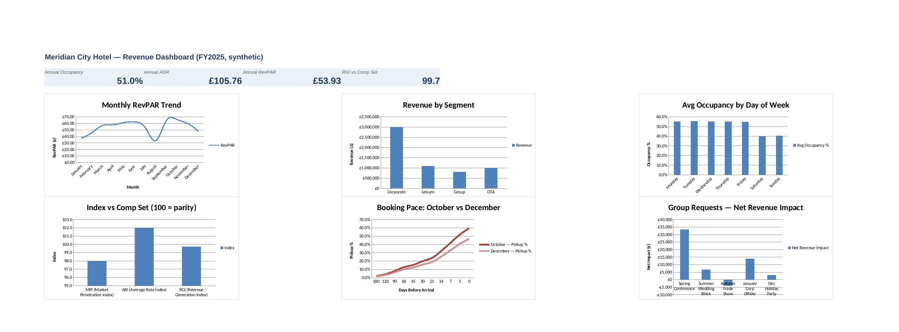

# Hotel Revenue & Demand Analysis

A synthetic revenue-management workbook built to demonstrate the analysis a hotel Revenue Analyst role requires — occupancy/ADR/RevPAR reporting, demand and booking-pace analysis, segment mix, competitive positioning, group displacement evaluation, and forward forecasting.

**Data:** Fully synthetic — one year (Jan–Dec 2025) of daily bookings for a fictional 300-room city-centre hotel ("Meridian City Hotel"). No real property, guest, or transaction data is used anywhere in this workbook.

## The business questions :-

- What's our occupancy, ADR and RevPAR — daily, weekly, monthly?
- Which segments and channels actually drive revenue, versus just volume?
- Are we pacing ahead of or behind where we should be at a given lead time?
- Is a given group request worth accepting, given what it would displace?
- Where do we sit against the competitive set, and is any gap a rate problem or a demand problem?

## Structure

| Tab | What it does |
|---|---|
| `Raw_Data` / `Daily_Totals` | Segment-level daily bookings, rolled up to one row per date |
| `KPI_Summary` / `Weekly_Summary` | Occupancy, ADR, RevPAR at monthly and weekly cadence |
| `Segment_Analysis` | Corporate / Leisure / Group / OTA — room nights, revenue, ADR, mix |
| `Demand_Pattern` | Occupancy and rate by day of week |
| `CompSet` | MPI / ARI / RGI against three illustrative competitor hotels |
| `Pickup_Detail` / `Pickup_Report` | Booking pace by lead-time bucket — October vs. December compared at the same days-before-arrival checkpoints |
| `Group_Displacement` | Five live group requests, each tested against the transient revenue it would displace |
| `Forecast` | Simple Q1 2026 projection off FY2025 actuals, editable growth assumptions |
| `Dashboard` | Six linked charts pulling from the tabs above |
| `Recommendations` | Seven findings, each tied to a specific number produced elsewhere in the workbook |

## A few of the findings

- Weekend occupancy runs ~15 points behind weekday occupancy (~40% vs. ~55%) — driven almost entirely by the corporate segment's absence at weekends.
- OTA carries the lowest ADR of the four segments (~£88 vs. a ~£105 hotel-wide average) and a disproportionately large share of room nights relative to revenue.
- December is pacing visibly behind October at the same lead-time checkpoint (e.g. ~16% of rooms on the books at 30 days out, vs. ~20% for October) — early enough to still act on.
- Of five group requests modelled, four are net-positive as quoted. One — a 270-room, 4-night block at a steep discount during the single highest-demand week of the year — is flagged as value-destructive (~‑£4,000 net impact), because of the transient business it would displace.

## Approach

Every summary figure is a live formula (`SUMIFS`, `AVERAGEIF`, `INDEX`/`MATCH`) referencing the raw data — nothing is hardcoded except a small number of clearly-marked, editable assumption cells (competitor comp-set estimates, forecast growth rates). Change an input in `Raw_Data` and the whole workbook recalculates.

## Tools

Excel (formulas, native charts, conditional structure) — no SQL or Python in this one; it's a deliberately Excel-first build, in keeping with the tool most revenue-management teams actually report in day to day.

## Preview

